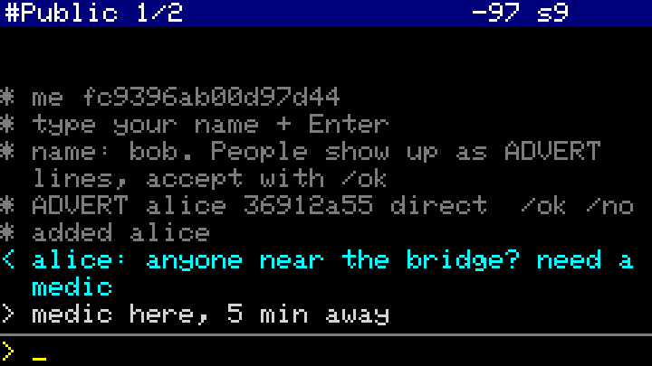

# 📟 cardcore

A standalone **[MeshCore](https://github.com/meshcore-dev/MeshCore)** client for the **M5Stack Cardputer ADV
+ Cap LoRa-1262** (SX1262, ATGM336H GPS). It chats with any MeshCore user and needs no phone, and it adds
push-to-talk voice messages between cardcore devices.

> **Status:** it builds and passes the end-to-end simulation against the real MeshCore library, but it
> hasn't been run on a physical Cardputer yet. Test it before you rely on it.

<p>


</p>

<sub>These screens come from <code>sh sim/run.sh</code>, the end-to-end test. It runs the unmodified
<code>src/main.cpp</code> and the real MeshCore library on a PC against a second simulated MeshCore node,
with stubbed hardware. They aren't photos.</sub>

```
pip install platformio
pio run -t upload        # hold G0 while plugging in if upload doesn't start
```

Or, without building: download `cardcore-<version>.bin` from [Releases](https://github.com/vdo/cardcore/releases) and flash it at offset 0x0
with `esptool.py --chip esp32s3 write_flash 0x0 cardcore-<version>.bin` or the browser-based [ESP flasher](https://espressif.github.io/esptool-js/).

## First boot


1. Type your name and press Enter. Your device sends an advert so others can find you.
2. People nearby show up as `ADVERT name 1a2b3c4d 1 hop  /ok /no`. `/ok` adds the newest one, and
   `/add name` adds a specific one. Check keys in person: `/fp` shows yours and the contact's.
3. Press Tab to reach the contact, type and press Enter. You're in the **#Public** channel from the start.

## Keys / commands
| | |
|---|---|
| Tab | next chat: channels first, then contacts |
| `/ok` `/add name` `/no` | add the newest advert, add a named one, or ignore the newest |
| `/join #name` `/join name <32-hex key>` `/leave` | hashtag or private channels |
| `/loc` | send your GPS position to the current chat |
| `/fp` | show your key and the contact's |
| `/advert` | announce yourself to the mesh |
| `/repeat on`/`off` | relay other people's packets (off by default, see [Range](#range)) |
| `/radio freq bw sf cr` | radio settings, default `869.618 62.5 8 5` |
| hold **G0** | record a voice message (release to send, max 20 s) |
| tap **G0** | replay the latest voice message in this chat; tap again to stop |
| `/voices` `/play n` | list saved voice messages in this chat, play #n |
| `/del` `/name x` | delete the current contact; change your name |
| `/help` | list the commands |

Message colours: cyan = received, white = sending, green = delivered (ACKed), red = failed after
3 tries (the last try floods), grey = sent to a channel (channels have no ACKs).
The header shows the chat, its route (`direct`, `2 hops`, or `flood` when no route is known yet), when
the contact was last heard, `ADV` when adverts are waiting, the RSSI of the last packet and the GPS satellite count.

The screen sleeps after 30 s. The first key press only wakes it, and incoming messages or adverts wake it too.

## Voice messages
Hold the **G0** side button and talk. When you let go, the message goes to the current contact.
Incoming voice messages **play automatically**, like a walkie-talkie, and are **saved to the SD card**,
so you can replay them later, even after a reboot. Voice works **between cardcore devices only**;
other MeshCore apps ignore it.

- **Codec2 at 1300 bps**, cut into 0.84 s chunks, one MeshCore request each. The chunks are end-to-end
  encrypted with the contact's MeshCore key, with a ChaCha20 layer inside: MeshCore's AES-ECB would
  otherwise show repeated frames such as silence. The receiver reports which chunks arrived, and the sender
  resends only the missing ones. The first chunk goes alone as a probe, so for a contact who can't play
  voice only that one chunk is sent (with up to 3 retries).
- **Needs a known route.** Send a text first so MeshCore learns the path from its ACK. Voice never floods
  the mesh: if the route is lost mid-message, the message fails instead.
- **Files** are saved as `/cardcore/NNNN_<peer>_<i|o>.c2`, standard Codec2 files. On a PC:
  `c2dec 1300 0007_….c2 out.raw && play -t raw -r 8000 -e signed -b 16 -c 1 out.raw`.
- **Airtime:** each chunk is about 1.06 s on air for 0.84 s of speech, so a 10 s message takes about
  13 s per hop. Be considerate on shared repeaters; MeshCore's own airtime budget paces the sending.
- **Half duplex:** while recording or playing, the radio misses packets.
- **No SD card:** voice still sends and plays, but nothing is saved.
- **Tuning:** speaker loudness is `VOLUME` at the top of `src/main.cpp`.

## Disaster use

### Battery life on a 20,000 mAh power bank
These are estimates from M5Stack's spec sheets, not measurements. Check yours with a USB-C power
meter: after the screen sleeps, read the watts; **hours ≈ 60 / W**.

| Mode | Draw (est.) | 20 Ah bank | + Cardputer's own 1750 mAh |
|---|---|---|---|
| Screen always on | ~0.6–0.7 W | ~3.5–4 days | +~9 h |
| Normal: screen asleep, listening | ~0.35–0.45 W | **~5.5–7 days** | +~15 h |

How these were worked out:
- **Usable energy:** the bank is rated at the cell, 20 Ah × 3.7 V = 74 Wh. After boost-to-5 V and
  cable losses, about **60 Wh** reaches the Cardputer.
- **Cardputer ADV:** 4.2 V × 120 mA ≈ 0.5 W with the screen on (M5Stack spec, stock 240 MHz CPU).
  This firmware runs at 80 MHz, lets the CPU idle and turns the screen off, which cuts that roughly in half.
- **GPS:** about 33 mA, always on. As far as is documented, it can't be switched off from software.
- **LoRa listening:** about 0.03 W.
- **LoRa sending:** about 0.6 W, but only while a packet is on air. Even with `/repeat on`, hundreds of
  packets a day cost well under 0.1 Wh, so traffic barely affects battery life.
- **Daily need:** about **10 Wh/day**. A 10 W foldable solar panel gives that in about 2–3 hours of real sun.

> ⚠️ **Power-bank auto-off:** many banks switch off when the load drops below ~50–150 mA, and
> with the screen asleep this firmware draws ~70–90 mA. If yours does, the Cardputer silently moves
> to its internal battery and dies about 15 h later. Test it: plug in, let the screen sleep and
> check after 5 minutes that the bank is still on. If it isn't, use a bank with a low-current
> or "always on" mode (often a double-press or long-press of its button).

Li-ion loses a lot of capacity below 0 °C. Keep the bank inside your jacket.

### Range
With MeshCore, **how far you reach depends on the network around you** more than on your radio:
- **Repeaters:** are there any within range of you and of the person you're writing to?
- **Load:** how busy is the mesh right now?
- **Routes:** which paths has MeshCore already learned?

Two people on opposite sides of a city can talk through a rooftop repeater. The same two people with no
repeater nearby are limited to one hop between their own devices.

The header shows the route to each contact: `direct`, `3 hops`, or `flood` while none is known yet.

Everything below is about **one hop**, from your Cardputer to the next device, whether that's the
other person or the nearest repeater.

Link budget: +22 dBm out, about −130 dBm sensitivity at SF8/62.5 kHz, and 0–3 dBi antennas give
**~152–158 dB** of allowed path loss for each hop.

In free space this would reach more than 1000 km. On the ground, **terrain, height and the
earth's curvature set the limit, not power**. The radio horizon between two people holding radios
at 1.5 m is ~10 km; with one antenna at 30 m it's ~28 km.

| Scenario (one hop) | Typical range |
|---|---|
| Dense city, street level, handheld | 0.5–2 km |
| Suburbs / small town | 1–4 km |
| Open flat land or water, handheld | 3–8 km |
| One node raised (roof, upper-floor window, hilltop) | 5–20 km |
| Hill to hill, clear line of sight | 30–100+ km |
| Indoors | each wall or floor costs 5–20 dB; concrete and basements often fail |

Getting more range:
- **Go higher.** Getting the antenna from 1.5 m up to 10 m does more than any setting.
- **Reach a repeater.** Any MeshCore repeater in range relays for you, along learned paths of up to 64 hops.
  If your messages only ever go out as `flood` and end red, probably no repeater hears you: move higher
  or outdoors.
- **Busy mesh?** Packets collide and MeshCore's airtime budget holds them back. Short texts get through
  far more reliably than voice, so keep voice for when it's quiet or the route is short.
- **No repeaters?** In a disaster, `/repeat on` on every Cardputer makes them relay for each other.
  Better still, put a spare Cardputer with `/repeat on`, or a cheap MeshCore repeater board, on a rooftop
  or hill with a power bank. With its screen asleep a Cardputer lasts about a week.
- **Mind the antenna.** Keep it vertical, away from your body and metal. A 5–6 dBi collinear antenna on
  a mast at the repeater is the next upgrade.
- **Change the settings** (every node must match): `/radio 869.618 62.5 10 5` gains about 5 dB (≈1.7×
  range in open terrain) for 4× the airtime. It also takes you off the public mesh.

Time on air at SF8/62.5 kHz: ACK 0.16 s, 30-character message 0.4 s, voice chunk 1.06 s. MeshCore
spaces out transmissions with its own airtime budget.

### EU band choice
The Cap's radio front end covers 868–923 MHz, so 433 MHz isn't an option. In the EU only these
licence-free sub-bands are usable for portable peer-to-peer radios:

| Band | Max power | Duty cycle | Who else is there | Verdict |
|---|---|---|---|---|
| 863–865 MHz | 25 mW | 0.1% | wireless audio | ~3 messages/hour, unusable |
| 865–868 MHz | 25 mW | 1% | 2 W RFID readers (865.7/866.3/866.9/867.5), LoRaWAN 867.x | low power, noisy |
| 868.0–868.6 MHz | 25 mW | 1% | LoRaWAN 868.1/.3/.5, Sigfox, Zigbee, smart home | busiest band in Europe |
| 868.7–869.2 MHz | 25 mW | 0.1% | smart meters (wM-Bus 868.95) | too little airtime |
| **869.4–869.65 MHz** | **500 mW** | **10%** | LoRaWAN RX2 + Meshtastic at 869.525, MeshCore at 869.618 | **only real option** |
| 869.7–870 MHz | 5 mW | none | Z-Wave 869.85 | about 1/20 of the range |
| 874 / 915–921 MHz | 25–500 mW | 1–10% | RFID, future rail | "data networks only": handhelds must be controlled by a fixed access point, so not for peer-to-peer |

cardcore uses MeshCore's EU/UK default, **869.618 MHz / 62.5 kHz / SF8**. That puts it on the public mesh
and its repeaters, in the upper part of the high-power sub-band and clear of the LoRaWAN downlink.

A group that wants its own frequency can switch every device to `/radio 869.435 62.5 9 5`, the quiet
lower edge below the LoRaWAN downlink. You lose the public repeaters, though. Interference is local: a
nearby gateway or alarm system can make another slot quieter where you are.
Limits per ERC Rec 70-03 Annex 1 and EU Decision 2018/1538. Check your national rules.

### Resilience checklist
- **Nothing to depend on.** Within radio range no grid, cell network, internet, phone or server is
  needed. Repeaters extend the range, but they aren't required.
- **Pair before you need it.** Accept contacts and compare keys (`/fp`) in person now. Contacts, routes,
  channels, keys and settings are kept in flash and survive dead batteries and reboots.
- **The clock matters.** MeshCore stamps messages with the time and the Cardputer has no RTC battery,
  so cardcore sets its clock from GPS (one fix per boot is enough), or else from contacts' adverts.
- **What a reboot loses:** text history and unsent messages, which live in RAM only. Voice messages are kept on the SD card.
- **Is someone reachable?** The header shows the route to each contact and when they were last heard.
- **Red message** = no ACK after 3 tries, the last of which floods. Move higher or outdoors, find a
  repeater or `/repeat on`, then resend.
- **Device lost or taken:** its keys are stored unencrypted. Everyone else should `/del` it, and
  private channels should move to a new key (`/leave`, then `/join` with a fresh one).
- **Weather:** the Cardputer isn't waterproof. A zip-lock bag works, because LoRa goes straight through thin plastic.

## How it works
- **MeshCore library** (a pinned commit in `platformio.ini`): Ed25519 identities, per-contact keys from
  ECDH, AES-128 with HMAC, flood-then-direct routing, ACKs and channels. cardcore implements the UI side
  of `BaseChatMesh`, and `meshcore.py` makes MeshCore build as a library dependency.
- **Storage:** the identity is generated on first boot with the hardware TRNG. It's kept in NVS together
  with contacts, channels and settings.
- **Development:** `pio run` builds the firmware. `sh sim/run.sh` runs the end-to-end test against real
  MeshCore and renders the screenshots (it needs SDL2 and one `pio run` first). CI runs both, plus
  clang-format and cppcheck, and makes a release on every tag.
