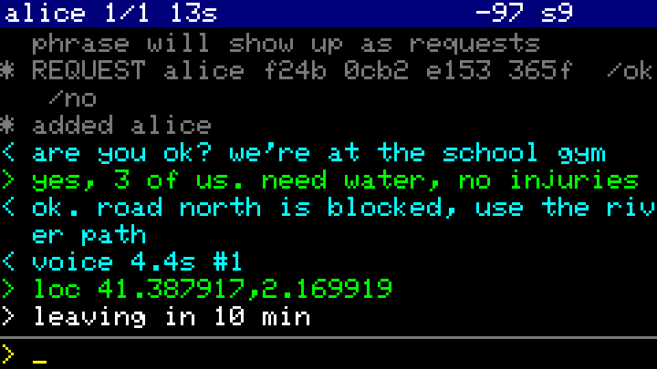
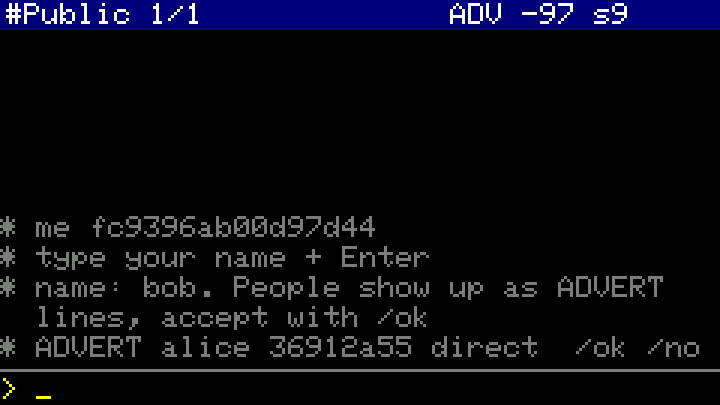
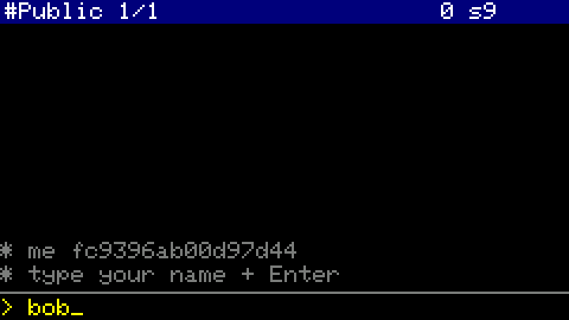

# 📟 cardxat

Encrypted LoRa chat for **M5Stack Cardputer ADV + Cap LoRa-1262** (SX1262, ATGM336H GPS).

<p>


</p>

<sub>These screens are the real firmware UI, rendered on a PC by <code>sh sim/run.sh</code>: the unmodified
<code>src/main.cpp</code> with stubbed hardware and a simulated second node. They aren't photos.</sub>

```
pip install platformio
pio run -t upload        # hold G0 while plugging in if upload doesn't start
```

Or, without building: download `cardxat-<version>.bin` from [Releases](https://github.com/vdo/cardxat/releases) and flash it at offset 0x0
with `esptool.py --chip esp32s3 write_flash 0x0 cardxat-<version>.bin` or the browser-based [ESP flasher](https://espressif.github.io/esptool-js/).

## Why not Meshtastic?
The goal is a **long-range encrypted text walkie-talkie**: two or more Cardputers that talk to each
other anywhere, whatever other networks are doing around them. Meshtastic is a general-purpose
mesh platform, and most of what it does is overhead for that goal:

- **Shared, busy channel.** Out of the box, Meshtastic nodes all use the same preset/frequency
  (EU: 869.525 MHz LongFast, also the LoRaWAN downlink channel) and a default channel whose key is public. In a city your messages
  compete for airtime with every public node in range, plus their rebroadcasts. cardxat uses its own
  frequency/bandwidth/SF and sync word, and drops anything not sealed with your passphrase after
  one MAC check. It never relays strangers' traffic.
- **Background chatter.** Meshtastic periodically broadcasts node info, position and telemetry by
  default, which costs airtime and duty cycle. cardxat sends one small beacon every ~5 min,
  plus your messages and their ACKs. Nothing else goes out.
- **Fewer bytes per message.** Protobuf framing, routing headers and channel metadata take payload
  space and airtime. cardxat has a fixed 70-byte overhead, and up to 185 characters fit in one packet.
- **No phone, no infrastructure.** Meshtastic is normally driven from a phone app over Bluetooth, and
  can bridge to MQTT/internet. cardxat runs on the Cardputer's own keyboard and screen. It needs no
  phone, app, account, internet, gateway or MQTT, so it works the same in a city or on a mountain.
- **Small enough to audit.** About 500 lines of app code plus Monocypher (a single audited C file).
  Every node is identified by its X25519 key, and you check fingerprints in person.

What you give up: no interop with Meshtastic or MeshCore devices, no smart routing (flood with
3 hops, fine for a handful of nodes, wasteful for hundreds), no phone app and no store-and-forward.

## First boot


1. Type your name + Enter.
2. Type the **network passphrase** + Enter. Only nodes with the same passphrase can see you
   (all traffic is encrypted with it); everyone else's packets are ignored. Use a long one.
3. Nodes on your network appear as `REQUEST name abcd 1234 ...` — check that fingerprint with
   the person (`/fp` on their device shows `me ...`), then `/ok` (or `/no`).
   They have to `/ok` you too. Then just type and Enter.

## Keys / commands
| | |
|---|---|
| Tab | next contact |
| `/ok` `/no` | accept / ignore the oldest request |
| `/loc` | send your GPS position to the current contact |
| `/fp` | show your fingerprint and the contact's |
| `/b` | send a beacon now (normally every ~5 min) |
| hold **G0** | record a voice message (release to send, max 20 s) |
| tap **G0** | replay the latest voice message in this chat; tap again to stop |
| `/voices` `/play n` | list saved voice messages in this chat, play #n |
| `/del` | delete current contact |
| `/name x` `/net x` | change name / network |

Message colours: white = sending, green = delivered (ACKed), red = failed after 3 tries.
Header: contact, last heard, `REQ` if a request is waiting, RSSI of the last packet, GPS satellites.

The screen sleeps after 30 s. The first key press only wakes it, and incoming messages or requests wake it too.

## Voice messages
Hold the **G0** side button and talk. When you let go, the message goes to the current contact.
Incoming voice messages **play automatically**, like a walkie-talkie, and are **saved to the SD card**,
so you can replay them later, even after a reboot.

- **Codec2 at 1300 bps**, cut into 1-second chunks of one LoRa packet each and encrypted end to end
  like text. The receiver reports which chunks arrived, and the sender resends only the missing ones.
- **Files** are saved as `/cardxat/NNNN_<peer>_<i|o>.c2`, standard Codec2 files. `/voices` lists them and
  `/play N` replays one. On a PC:
  `c2dec 1300 0007_….c2 out.raw && play -t raw -r 8000 -e signed -b 16 -c 1 out.raw`.
- **Airtime:** each second of voice is a ~2.5 s packet, so a 10 s message takes ~25 s to deliver. Within
  the 10% duty cycle that's roughly **2 minutes of voice per hour per node**, relays included.
  Text remains far cheaper on air.
- **Half duplex:** while recording or playing, the radio keeps only the last packet that arrives.
- **No SD card:** voice still sends and plays, but nothing is saved.
- **Tuning:** speaker loudness is `VOLUME` at the top of `src/main.cpp`.

## Disaster use

### Battery life on a 20,000 mAh power bank
These are estimates from M5Stack's spec sheets, not measurements. Check yours with a USB-C power
meter: after the screen sleeps, read the watts; **hours ≈ 60 / W**.

| Mode | Draw (est.) | 20 Ah bank | + Cardputer's own 1750 mAh |
|---|---|---|---|
| Screen always on | ~0.6–0.7 W | ~3.5–4 days | +~9 h |
| Normal: screen asleep, listening + relaying | ~0.35–0.45 W | **~5.5–7 days** | +~15 h |

How these were worked out:
- **Usable energy:** the bank is rated at the cell, 20 Ah × 3.7 V = 74 Wh. After boost-to-5 V and
  cable losses, about **60 Wh** reaches the Cardputer.
- **Cardputer ADV:** 4.2 V × 120 mA ≈ 0.5 W with the screen on (M5Stack spec, stock 240 MHz CPU).
  This firmware runs at 80 MHz, lets the CPU idle and turns the screen off, which cuts that roughly in half.
- **GPS:** about 33 mA, always on. As far as is documented, it can't be switched off from software.
- **LoRa listening:** about 0.03 W.
- **LoRa sending:** about 0.6 W, but only while a packet is on air (about 1 s each). Even 100
  packets a day, relays included, cost about 0.02 Wh, so traffic barely affects battery life.
- **Daily need:** about **10 Wh/day**. A 10 W foldable solar panel gives that in about 2–3 hours of real sun.

> ⚠️ **Power-bank auto-off:** many banks switch off when the load drops below ~50–150 mA, and
> with the screen asleep this firmware draws ~70–90 mA. If yours does, the Cardputer silently moves
> to its internal battery and dies about 15 h later. Test it: plug in, let the screen sleep and
> check after 5 minutes that the bank is still on. If it isn't, use a bank with a low-current
> or "always on" mode (often a double-press or long-press of its button).

Li-ion loses a lot of capacity below 0 °C. Keep the bank inside your jacket.

### Range
Link budget: +22 dBm out, about −132 dBm sensitivity at SF9/62.5 kHz, and 0–3 dBi antennas give
**~154–160 dB** of allowed path loss. That's about the same as Meshtastic's LongFast preset, so
real-world reports from that community carry over.

In free space this would reach more than 1000 km. On the ground, **terrain, height and the
earth's curvature set the limit, not power**. The radio horizon between two people holding radios
at 1.5 m is ~10 km; with one antenna at 30 m it's ~28 km.

| Scenario (one hop) | Typical range |
|---|---|
| Dense city, street level, handheld | 0.5–2 km |
| Suburbs / small town | 1–4 km |
| Open flat land or water, handheld | 3–10 km |
| One node raised (roof, upper-floor window, hilltop) | 5–20 km |
| Hill to hill, clear line of sight | 30–100+ km |
| Indoors | each wall or floor costs 5–20 dB; concrete and basements often fail |

Getting more range:
- **Go higher.** Getting the antenna from 1.5 m up to 10 m does more than any setting.
- **Add a relay.** Every node relays automatically, for up to 3 hops, and each hop adds about one more
  single-hop range. The best upgrade is a spare Cardputer on a power bank on a rooftop or hill.
  It only needs a name and the network passphrase, no contacts. With its screen asleep it runs about a week.
- **Mind the antenna.** Keep it vertical on every node, away from your body and metal. A 5–6 dBi
  collinear antenna on a mast at the relay is the next upgrade.
- **Change the settings** (every node must match): SF11 gains about 5 dB (≈1.7× range in open
  terrain), but a message takes about 4.4 s instead of 1.1 s; raise `ACK_MS` with it. TX power is already
  at the chip's maximum.

Time on air: ACK 0.8 s, beacon 1.0 s, 30-character message 1.1 s, 185-character message 2.5 s.
The legal 10% duty cycle allows about 350 packets per hour per node. The firmware doesn't track that.

### EU band choice
The Cap's radio front end covers 868–923 MHz, so 433 MHz isn't an option. In the EU only these
licence-free sub-bands are usable for portable peer-to-peer radios:

| Band | Max power | Duty cycle | Who else is there | Verdict |
|---|---|---|---|---|
| 863–865 MHz | 25 mW | 0.1% | wireless audio | ~3 messages/hour, unusable |
| 865–868 MHz | 25 mW | 1% | 2 W RFID readers (865.7/866.3/866.9/867.5), LoRaWAN 867.x | low power, noisy |
| 868.0–868.6 MHz | 25 mW | 1% | LoRaWAN 868.1/.3/.5, Sigfox, Zigbee, smart home | busiest band in Europe |
| 868.7–869.2 MHz | 25 mW | 0.1% | smart meters (wM-Bus 868.95) | too little airtime |
| **869.4–869.65 MHz** | **500 mW** | **10%** | LoRaWAN RX2 + Meshtastic at 869.525, MeshCore at 869.618 | **only real option** |
| 869.7–870 MHz | 5 mW | none | Z-Wave 869.85 | about 1/20 of the range |
| 874 / 915–921 MHz | 25–500 mW | 1–10% | RFID, future rail | "data networks only": handhelds must be controlled by a fixed access point, so not for peer-to-peer |

cardxat uses **869.435 MHz at 62.5 kHz**, the lower edge of the high-power sub-band (869.404–869.466 MHz).
That keeps it entirely below the LoRaWAN downlink channel (869.4625–869.5875 MHz, where gateways transmit at 27 dBm),
off Meshtastic's centre and well away from MeshCore. Meshtastic's 250 kHz channel still overlaps it, but a
different bandwidth, SF and sync word make those packets nearly invisible to the receiver. SF9 at 62.5 kHz has
the same sensitivity as SF10 at 125 kHz for about the same airtime. Interference is local, though:
a nearby gateway or alarm system can still make another slot quieter where you are.
Limits per ERC Rec 70-03 Annex 1 and EU Decision 2018/1538. Check your national rules.

### Resilience checklist
- **Nothing to depend on.** No grid, cell network, internet, phone, server or GPS is needed
  for messaging. GPS is only used for `/loc`. A cold fix takes about 23 s outdoors and often fails indoors.
- **Pair before you need it.** Accept contacts and compare fingerprints in person now. Contacts,
  keys, name and passphrase are kept in flash and survive dead batteries and reboots.
- **What a reboot loses:** text history and unsent messages, which live in RAM only. Voice messages are kept on the SD card.
- **Is someone reachable?** The header shows when each contact was last heard. Beacons every ~5 min
  keep it fresh even when nobody types.
- **Red message** = no ACK after 3 tries (~45 s). Move higher or outdoors, or wait for a relay, then resend.
- **Device lost or taken:** its keys are stored unencrypted, so everyone else should `/del` it and
  switch to a new `/net` passphrase.
- **Weather:** the Cardputer isn't waterproof. A zip-lock bag works, because LoRa goes straight through thin plastic.

## How it works
- Identity: X25519 key generated on first boot (hardware TRNG), stored in NVS.
- Every packet: XChaCha20-Poly1305 with a key from the network passphrase. DMs/ACKs are also
  sealed end-to-end with the X25519 shared key, so other network members relay them but can't read them.
- Every node re-broadcasts packets it hasn't seen (hop limit 3), so contacts out of direct range
  are reachable through others.
- Radio: 869.435 MHz, BW 62.5 kHz, SF9, 22 dBm (see [EU band choice](#eu-band-choice)). Settings are at the top of
  `src/main.cpp`; all nodes must match.

Protocol self-test on a PC:
`cc -c lib/monocypher/monocypher.c -o /tmp/m.o && c++ -std=c++17 -Isrc -Ilib/monocypher test/test_proto.cpp /tmp/m.o -o /tmp/t && /tmp/t`
