# CARDCORE

MeshCore companion firmware for the **M5Stack Cardputer ADV** with the **Cap LoRa-1262**: a standalone mesh messenger with a keyboard UI. Public, #hashtag and private channels, direct messages, rooms, repeater admin, metrics, GPS and a world map. The MeshCore phone app can still connect over Bluetooth or USB at the same time.

Preconfigured for **MeshCore Catalunya** ([radio config](https://docs.livemap-meshcorecat.com/configuracio-radio/)): 869.618 MHz, BW 62.5 kHz, SF7, CR6, 22 dBm, 2-byte path hashes, with the Public channel. The other community presets are one keypress away (Settings → TEMPLATE).

UI language: English, Català, Español (Settings → LANGUAGE; Català by default). The look and keys follow [FRESNELDRONE](https://github.com/vdo/fresneldrone).

## Screens

Rendered by the firmware's own drawing code (`test/host.cpp`).

| | |
|---|---|
| 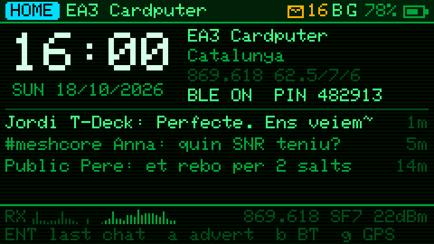 | 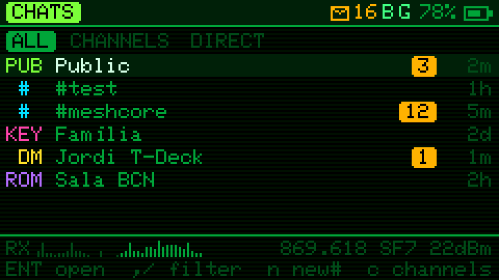 |
| **Home** (`1`): clock, node, preset, BLE PIN, latest messages | **Chats** (`2`): Public, #hashtags, private channels, DMs, rooms, with unread counts. `,/` filters |
| 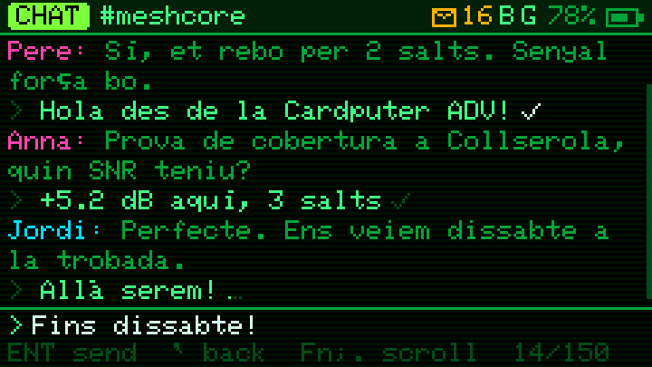 | 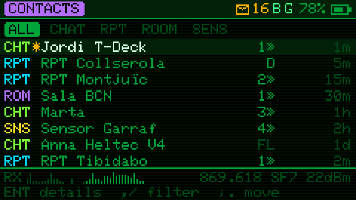 |
| **Chat**: type and press Enter. ✓ means delivered (DMs retry twice, then flood). `Fn+;` `Fn+.` scroll back to show hops/SNR | **Contacts** (`3`): type, favourite, hops (`2»`, `D` direct, `FL` flood), last heard |
| 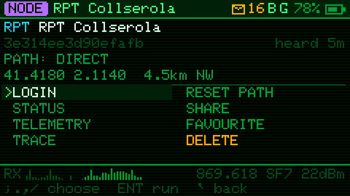 | 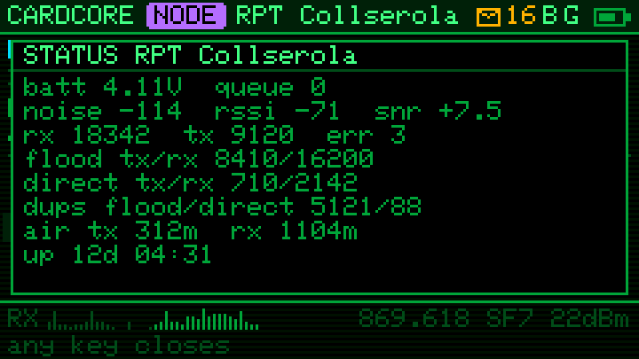 |
| **Contact**: path, location and distance. Actions: message, login, status, telemetry, trace, reset path, share, favourite, delete | **Status** of a repeater (also telemetry, trace, login results) |
| 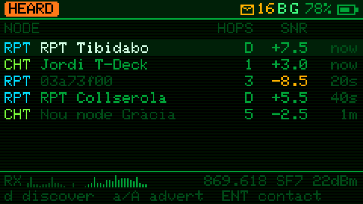 | 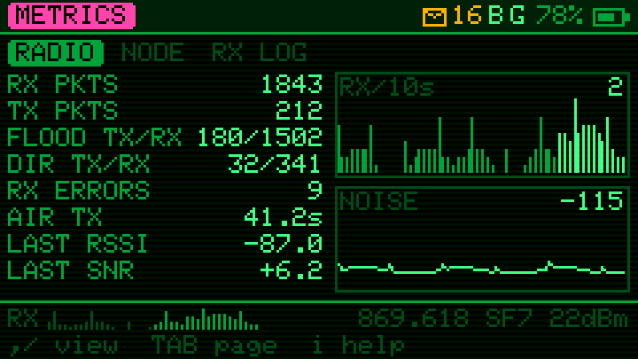 |
| **Heard** (`4`): adverts and discovery answers with hops/SNR. `d` discovers nearby repeaters | **Metrics** (`5`): packets, flood/direct, airtime, RSSI/SNR, RX rate and noise floor graphs |
| 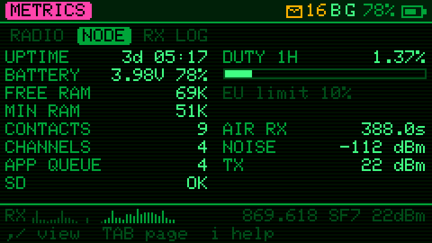 | 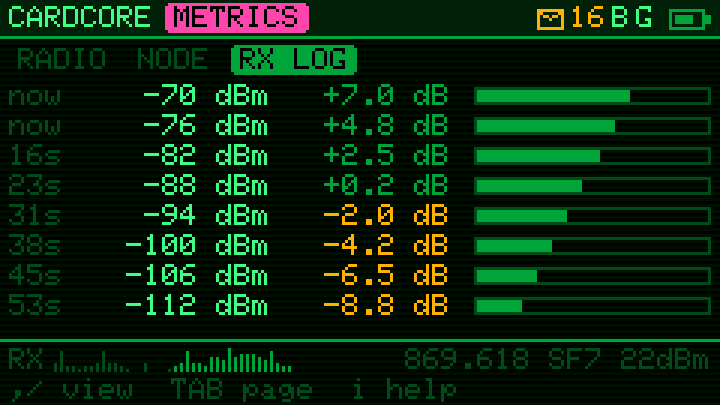 |
| **Node**: uptime, battery, RAM, 1 h duty cycle against the EU 10 % limit | **RX log**: the last packets' RSSI/SNR |
| 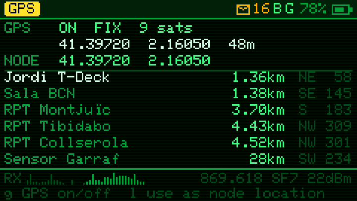 | 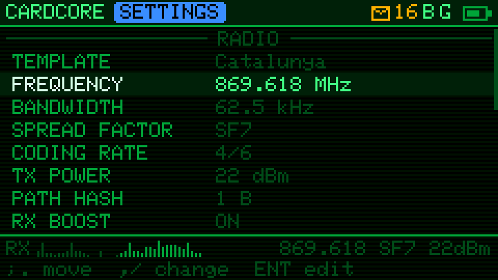 |
| **GPS** (`6`): fix, node location, nearest contacts with distance and bearing | **Settings** (`8`): radio, node, contacts, phone, GPS, display, alerts, system |
| 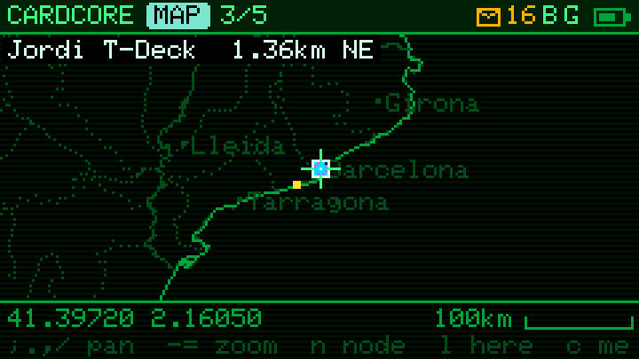 | 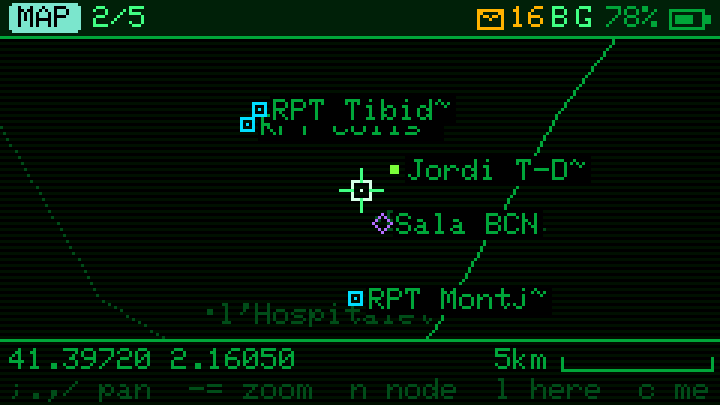 |
| **Map** (`7`): opens on Catalonia, centred on you: coast, borders, provinces, rivers, big towns. The node under the crosshair is named with its distance from you | Local zoom (100 m/px; street zoom is 25 m/px): node names, all towns. `l` puts your location at the crosshair |
| 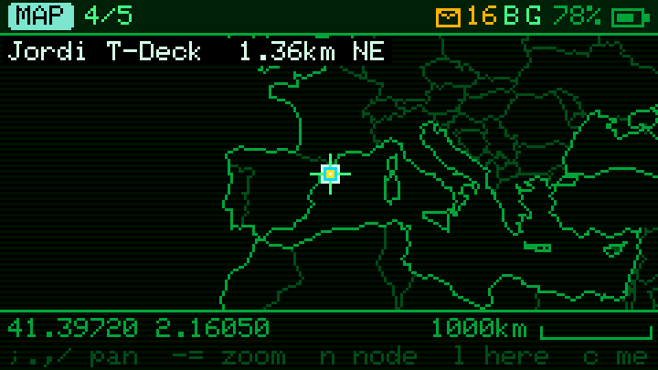 | 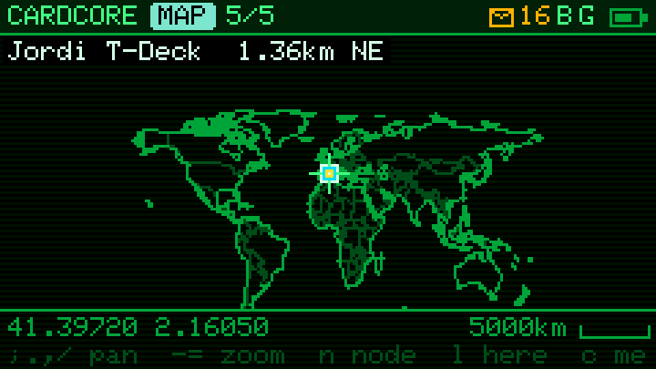 |
| Europe (25 km/px) | World (200 km/px). Five zoom levels with `-` `=`; `n` jumps from node to node, Enter opens it |
| 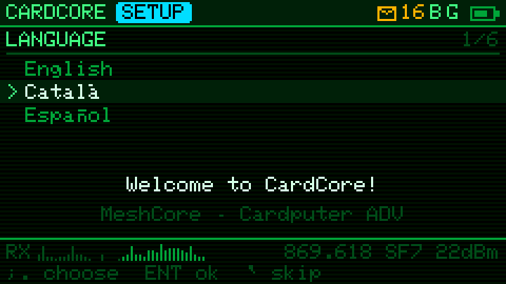 | 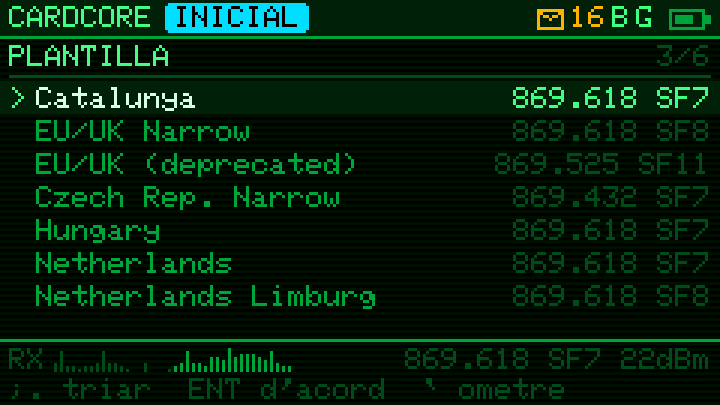 |
| **Setup wizard** on first boot (and after a factory reset): language, name, template, location, Bluetooth, then a flood advert. `` ` `` skips a step | Template step: Catalunya preselected |
| 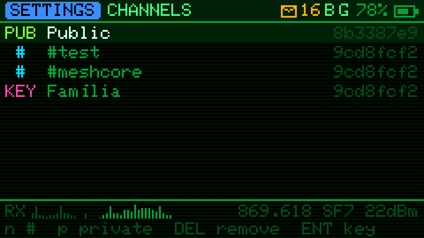 | 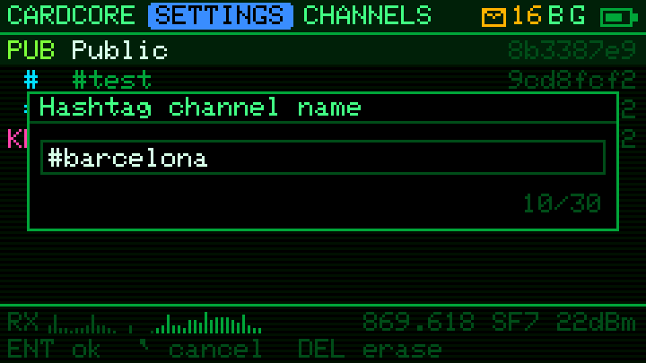 |
| **Channels** (`c` on Chats): `n` hashtag, `p` private (32 hex key), Del removes, Enter shows the key | Adding `#barcelona`: its key is `sha256("#barcelona")`, as in the MeshCore app |
| 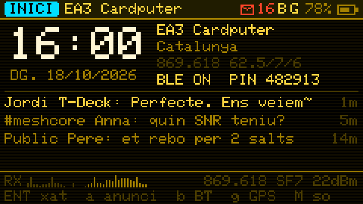 | 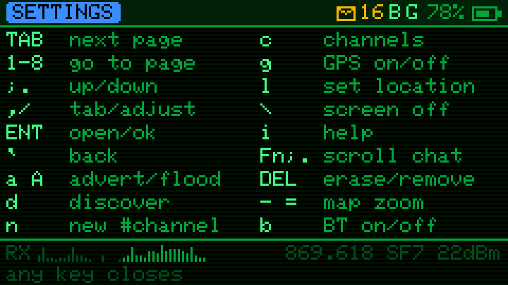 |
| Català, AMBER theme (5 themes) | **Help** (`i`) |

## Keys

| Key | Action |
|---|---|
| `Tab` / `1`–`8` | next page / go to page: Home, Chats, Contacts, Heard, Metrics, GPS, Map, Settings |
| `;` `.` `,` `/` | up, down, left, right (in text fields: `Fn` + these) |
| `Enter` | open, send, edit, run |
| `` ` `` | back, cancel |
| `a` / `A` | advert (zero hop) / flood advert |
| `d` | discover nearby repeaters (Heard) |
| `n` / `c` | new #hashtag channel / channel manager (Chats) |
| `g` / `l` | GPS on/off / use the fix as the node location (GPS) |
| `-` `=` | map zoom: street, local, Catalonia, Europe, world |
| `n` / `c` / `l` | map: next located node / centre on me / set my location at the crosshair |
| `Del` | backspace; remove a channel (Channels) |
| `\` | screen off (any key wakes it) |
| `i` | help |

## Settings

- **Radio:** template (24 presets, Catalunya first), frequency, bandwidth, SF, CR, TX power, path hash size (1–3 B), RX boost, region scope (`#name`), relay (client repeat; only on MeshCore's off-grid frequencies such as 869.495).
- **Node:** name, location, share location in adverts, advert / flood advert, channels.
- **Contacts:** auto-add (all or by type: chat, repeater, room, sensor), overwrite oldest, max hops.
- **Phone app:** Bluetooth on/off, BLE PIN (blank = random each boot, shown on Home). USB companion is always on.
- **GPS:** on/off, interval.
- **Time:** zone (UTC+1 by default), summer time (automatic EU rule by default), set time by hand (`YYYY-MM-DD HH:MM`, local; like MeshCore, never backwards). GPS and the phone app also set the clock.
- **Display:** theme, brightness, screen-off timeout, language.
- **Alerts:** sound (speaker), volume, LED.
- **System:** SD card (remount), about (versions, public key), reboot, factory reset.

Chat history is stored on the microSD card under `/cardcore/` when one is inserted. Without a card it goes to internal flash, keeping the last ~4–8 KB per chat. Grove-port I2C sensors (BME280, SHT4x, INA219…) are picked up for telemetry.

## Build / flash

```sh
git clone --recursive <this repo>   # MeshCore is a submodule, pinned at v1.18.0
pio run -t upload                   # Cardputer ADV over USB-C
```

The build also writes `cardcore.bin` (bootloader, partitions and app merged). To flash it without PlatformIO, use [ESPConnect](https://thelastoutpostworkshop.github.io/ESPConnect/) at offset `0x0`. If the Cardputer doesn't show up, hold G0 while plugging in USB.

MeshCore stays untouched: `platformio.ini` builds its `src/` and `companion_radio` example the way MeshCore does, and `src/` adds the board target (`target.*`), the keyboard UI (`ui.cpp`) and the glue to the mesh (`app.cpp`).

Map data (`src/map_world.h`, ~3.6 MB of flash, worldwide): [Natural Earth](https://www.naturalearthdata.com/) (public domain) 1:110m coastlines and borders for the wide zooms; 1:10m coastlines, borders, provinces, rivers and towns from the Catalonia zoom in. Also Catalonia's outline from IGN via [click_that_hood](https://github.com/codeforgermany/click_that_hood), plus a hand-made list of Catalan towns. `tools/mkmap.py` regenerates it; its docstring lists the input files.

To fit, `partitions.csv` merges the two 3.3 MB app slots of the stock 8 MB layout into one 6.4 MB slot (the companion never updates over the air). The data partitions keep their offsets, so flashing over an older build keeps identity, contacts and settings.

### Laptop check

Asserts the pure helpers (UTF-8 → font, word wrap, chat log format, telemetry, presets, every translation fits its slot), then renders `docs/*.png`:

```sh
c++ -std=c++17 -O1 -Isrc -I.pio/libdeps/cardcore/M5GFX/src/lgfx/Fonts test/host.cpp -lz -o /tmp/cc_host && /tmp/cc_host docs
```

On macOS with a newer SDK than its linker understands, add `-isysroot /Library/Developer/CommandLineTools/SDKs/MacOSX26.5.sdk`.

## Hardware notes

- **Cap LoRa-1262:** NSS G5, IRQ G4, RST G3, BUSY G6, SPI on G40/G39/G14, shared with the microSD card (CS G12). The RF switch is powered by P0 of the cap's PI4IOE5V6408 (0x43) and driven by DIO2. TCXO at 3.0 V; MeshCore retries without it.
- **GNSS:** UART at 115200, MCU RX G15, TX G13.
- **I2C:** M5Unified owns the internal bus (G8/G9: keyboard, cap expander). MeshCore's `Wire` runs on the Grove port (G2/G1).

## Known limits

- Rooms: there is no keep-alive after login, because MeshCore keeps `startConnection` protected. Log in again if a room goes quiet.
- Messages you send from the Cardputer don't appear in the phone app, and vice versa. Incoming messages reach both.
- Text entry is ASCII (the keyboard has no accent keys). Received accents display where the 6×8 font has them; emoji show as `?`.
- Not yet tested on hardware: built and rendered, not run. First-boot report welcome.
